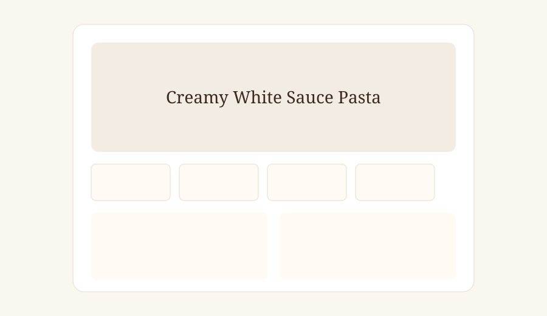
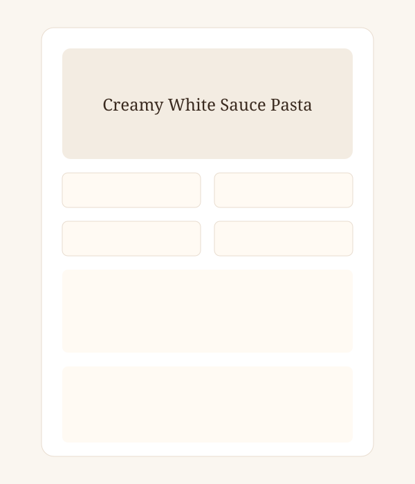
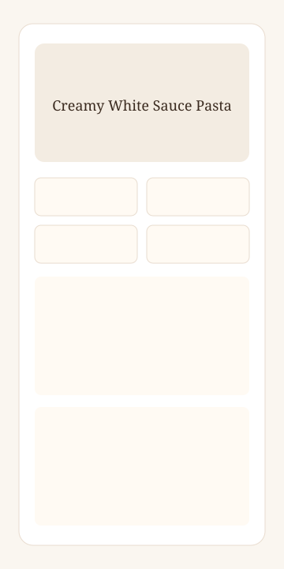

<div align="center">
  

  

  <p><b>Warm Ivory • Forest Green • Lime Accent • Horizontal Layout • Interactive • Responsive</b></p>

  
  
  
  
  
  

</div>

---

<div align="center">
  
</div>

Redesigned Recipe Card Page of **Abhishek Jadhav** — Web Developer & first-year BCA student at VIIT, Baramati. Built with **HTML5 + CSS3 + Vanilla JavaScript**: a horizontal, editorial-style recipe card for Creamy White Sauce Pasta with an interactive ingredient checklist and progress indicator. No frameworks, no build step, no backend.

> **Internship attribution:** 45-day Web Development Internship at **Veda Technology** — Day 11: Recipe Card Page (redesigned).

<details>
<summary><b>📖 Table of Contents (click to expand)</b></summary>

- [✨ Features](#-features)
- [🛠️ Technologies](#️-technologies)
- [🗂️ How the Card Is Built](#️-how-the-card-is-built)
- [♿ Accessibility](#-accessibility)
- [📁 Project Structure](#-project-structure)
- [🚀 How to Run](#-how-to-run)
- [🔗 Profile Links](#-profile-links)
- [📸 Screenshots](#-screenshots)
- [🧪 Testing Checklist](#-testing-checklist)
- [🌐 Deployment](#-deployment)
- [⚠️ Limitations](#️-limitations)
- [🔍 Accuracy Notes](#-accuracy-notes)

</details>

## ✨ Features

<div align="center">
  
</div>

- **🍽️ Horizontal landscape card** — image on the left (42%), recipe content on the right (58%), ~1120px wide.
- **🖼️ Prominent food image** — fills the left column, rounded outer-left corners, subtle hover zoom, graceful fallback.
- **⏱️ Recipe details** — prep 10 min, cook 15 min, total 25 min, serves 2.
- **🏷️ Tags** — Difficulty: Easy, Vegetarian, Kid-friendly.
- **🥬 Ingredients** — semantic `ul` with 12 items; click to toggle checked state.
- **📊 Progress indicator** — updates as ingredients are checked.
- **👨‍🍳 Preparation steps** — semantic `ol` with 7 steps and staggered entrance animation.
- **💡 Chef's tip** — serving suggestion in a highlighted block.
- **📱 Responsive** — single column on tablet/mobile; no horizontal overflow.
- **♿ Accessible** — skip link, semantic landmarks, alt text, focus ring, reduced-motion, forced-colors.
- **🎨 Editorial theme** — warm ivory, deep forest green, lime accent, charcoal text.

---

## 🛠️ Technologies

| Technology | Use |
|------------|-----|
|  | Semantic landmarks, native lists, figure/figcaption, meta tags, skip link (`index.html`) |
|  | Custom properties, Grid, Flexbox, `clamp()`, aspect-ratio, animations, media queries, reduced-motion (`style.css`) |
|  | Ingredient checkboxes, progress indicator, checked styling (`script.js`) |
|  | Zero dependencies |
|  | Georgia display + system sans (no web-font request) |
|  + GitHub Pages | Version control + static hosting |

---

## 🗂️ How the Card Is Built

The markup is a two-column `<article>` recipe card:

```html
<article class="recipe-card">
  <figure class="recipe-card__media">… image …</figure>
  <div class="recipe-card__content">
    … title, stats, tags, ingredients + progress, steps, tip …
  </div>
</article>
```

CSS Grid drives the horizontal layout (`42% 58%`), collapsing to one column below 980px. Animations use `card-in`, `image-in`, and `step-in` keyframes with restrained timing.

---

## ♿ Accessibility

| Requirement | How it's met |
|-------------|--------------|
| Semantic HTML | `<main>`, `<article>`, `<section>`, `<figure>`, `<figcaption>`, `<header>`, `<footer>`, `<ul>`, `<ol>` |
| Image alt text | Descriptive `alt` on the food image |
| Image fallback | `onerror` swaps to a second image if the first fails |
| Progressbar | `role="progressbar"` with `aria-valuenow/min/max` |
| Keyboard operable | Skip link + visible `:focus-visible` ring |
| Reduced motion | `prefers-reduced-motion: reduce` disables animations |
| High contrast | `forced-colors: active` adds borders |
| Colour contrast | Charcoal text on ivory/white surfaces |

---

## 📁 Project Structure

```text
internship-task-11/
├── index.html                                       # Semantic markup + meta + footer
├── style.css                                        # Tokens, horizontal layout, animations
├── script.js                                        # Ingredient checklist + progress
├── README.md                                        # This file
├── Veda_Technology_Task_11_Project_Report.docx       # Internship project report
└── assets/
    ├── favicon.svg                                  # Forest-green favicon
    ├── screenshot-desktop.svg                       # Desktop capture
    ├── screenshot-tablet.svg                        # Tablet capture
    └── screenshot-mobile.svg                        # Mobile capture
```

All paths are **relative** (`./style.css`, `./script.js`) for GitHub Pages compatibility.

---

## 🚀 How to Run

<div align="center">
  
</div>

No install or build step. ✨

1. 📂 Open the `internship-task-11` folder.
2. 🖱️ Double-click `index.html` → opens in Chrome / Edge / Firefox.
   - Or right-click `index.html` → **Open with** → your browser.
   - Or serve it: `python -m http.server 8000` → <http://localhost:8000>
   - Or VS Code **Live Server**: right-click `index.html` → **Open with Live Server**.
3. 🎉 Styling loads from `style.css`, logic from `script.js`.

Quick syntax check (Node, from the project folder):

```powershell
node --check script.js
```

---

## 🔗 Profile Links

| Profile | Link |
|---------|------|
|  | https://github.com/0xAbhi13 |
|  | https://www.linkedin.com/in/0xabhi13/ |
|  | https://0xabhi13.github.io/MyPortfolio/ |

---

## 📸 Screenshots

**Desktop — horizontal card**



**Tablet — stacked layout**



**Mobile — single column**



---

## 🧪 Testing Checklist

**Real browser:**

- [x] Page loads from `file://`; `style.css` and `script.js` load; **no console errors**.
- [x] Desktop card is horizontal: image left, content right.
- [x] Card is ~1120px wide with balanced height.
- [x] Ingredients render as a native `<ul>` with 12 items.
- [x] Preparation steps render as a native `<ol>` with 7 numbered items.
- [x] Meta tiles show Prep 10 min, Cook 15 min, Total 25 min, Servings 2.
- [x] Clicking an ingredient toggles its checked state and strikes through the text.
- [x] Progress bar and count update as ingredients are checked.
- [x] Food image loads from Pexels; fallback swaps in if it fails.
- [x] Layout has no horizontal scrolling at ~320 / 375 / 768 / 1024 / desktop widths.
- [x] Single-column layout below 980px.
- [x] `prefers-reduced-motion: reduce` disables animations.
- [x] Visible `:focus-visible` ring on skip link and controls.
- [x] `node --check script.js` passes.

---

## 🌐 Deployment

**GitHub Pages:**

```powershell
Set-Location "<path-to>\internship-task-11"
git init -b main
git add index.html style.css script.js README.md Veda_Technology_Task_11_Project_Report.docx assets
git commit -m "Day 11: Recipe Card Page redesign (HTML + CSS + JS)"
git remote add origin <your-repository-url>
git push -u origin main
```

Then GitHub → **Settings → Pages → Deploy from a branch → `main` / root** → GitHub shows your live URL.

> Keep `index.html`, `style.css`, `script.js`, and `assets/` together with relative links so Pages resolves them correctly. The repository URL above is a placeholder — replace it with your real repo.
> **Nothing has been committed or pushed yet, and no repository has been created**; the commands are provided for the submission step only.

---

## ⚠️ Limitations

- **Single recipe** — only Creamy White Sauce Pasta is presented.
- **Image depends on the network** — loaded from Pexels; `onerror` fallback covers a single failure.
- **Progress resets on reload** — checked state is not persisted.
- **No print stylesheet** — optional enhancement for later days.

---

## 🔍 Accuracy Notes

- Every test result above comes from checks executed against these files — no invented numbers.
- 12 ingredients and 7 steps match the recipe content exactly.
- Semantic elements are present and correct.
- Lists use native `ul`/`ol` elements.
- Alt text is present on the food image.
- Skills are presented as *learning/using* at internship level.
- The page makes no network requests beyond the food image.

---

<div align="center">
  
  <p><sub>Veda Technology Internship — Day 11: Recipe Card Page • HTML5 • CSS3 • Vanilla JavaScript ✨</sub></p>
</div>
